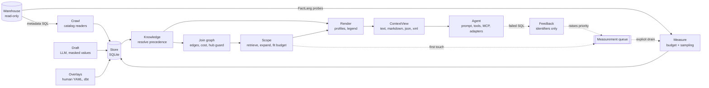
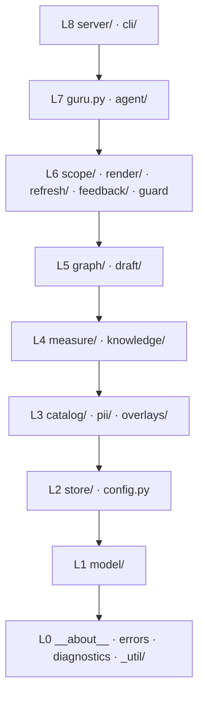

# Architecture

> SchemaGuru is a library of nine layers (L0 to L8), each importing only from itself or lower layers, and a test enforces it.
> Knowledge flows one way: crawl the catalog, measure facts, add drafts and human overlays, resolve them, build the join graph, scope to a question, render a view, hand it to the agent.
> Everything is stored in one local store (SQLite by default), and only three modules ever talk to FactLang, the claim language that does all measurement.

## The big picture

```text
                 ┌─────────────────────── agent surface ───────────────────────┐
                 │ Python API · tool specs · MCP server · framework adapters   │
                 └───────────────▲─────────────────────────────▲───────────────┘
                                 │                             │
             ┌──── scoping & rendering (views) ────┐     ┌─ feedback ──┐
             │ retrieval · graph expansion · budget│     │ error intake│
             └───────▲──────────────────▲──────────┘     └─────▲───────┘
                     │                  │                      │
        ┌──── knowledge (resolve) ────┐ ┌──── join graph ────┐  │
        │ facts + precedence          │ │ cost · search · hub│  │
        └──▲────────▲─────────▲───────┘ └─────────▲──────────┘  │
           │        │         │                   │             │
   ┌── crawl ──┐ ┌─ measure ─┐ ┌─ draft (LLM) ─┐ ┌─ overlays ─┐ ┌─ refresh ─┐
   │ catalogs  │ │ FactLang  │ │ pii mask      │ │ YAML human │ │ drift diff│
   └────▲──────┘ └────▲──────┘ └──────▲────────┘ └────────────┘ └───────────┘
        │             │               │
   ┌────┴─────────────┴─── store (SQLite default) ──────────────────────────┐
   └────────────────────────────────────────────────────────────────────────┘
        │             │
   catalog readers   FactLang connectors  ──►  warehouse (read-only)
```

## Data flow

The same flow as a Mermaid diagram (GitHub renders it):



Two things to notice:

- **The dashed arrows never spend money on their own.** A question that touches an unmeasured
  table only *enqueues* it. The queue is drained by an explicit `guru.measure()`,
  `schemaguru worker`, a refresh, or by a background thread you opt into
  ([[Configuration]] `measure_on_demand`).
- **Nothing on the agent's path writes knowledge.** `context()` and the agent tools read the
  store; the only write is the queue entry. Feedback from failed queries is queued as identifiers
  and counts and acted on at the next refresh.

## The layers

A module imports only from its own package or strictly lower layers (module-level imports; a
lazy import inside a function is the escape hatch for optional extras). This is enforced by
[`tests/architecture/test_layers.py`](https://github.com/rupakc/schemaguru/blob/main/tests/architecture/test_layers.py).



| Layer | Packages | Responsibility | Wiki page |
|---|---|---|---|
| L0 | `__about__`, `errors`, `diagnostics`, `_util/` | version, exception base, `Diagnostic`, stdlib helpers | [[Diagnostics]] |
| L1 | `model/` | `ObjectRef`, `Fact`, `FactKind`, `Status`, `JoinRef`, `Chain`, `Evidence` | [[Concepts]] |
| L2 | `store/`, `config.py` | the `Store` protocol and `SQLiteStore`; `Config` dataclasses | [[Store]], [[Configuration]] |
| L3 | `catalog/`, `pii/`, `overlays/` | catalog readers and the crawl; PII detectors and masking; YAML overlays and dbt import | [[Catalog-and-Crawl]], [[PII-and-Sampling-Policy]], [[Overlays]] |
| L4 | `measure/`, `knowledge/` | probe planning, budget, sampling, scheduler, join candidates; precedence and diffs | [[Measurement]], [[Sampling]], [[Concepts]] |
| L5 | `graph/`, `draft/` | edges, hop cost, path search, hub guard, waypoint rules, chains; LLM drafting | [[Join-Graph]], [[Path-Search-and-Hub-Guard]], [[Waypoint-Rules]], [[Drafting]] |
| L6 | `scope/`, `render/`, `refresh/`, `feedback/`, `guard.py` | retrieval and budget fitting; views and fingerprints; drift; error intake; SQL guard | [[Scoping]], [[Rendering]], [[Refresh-and-Drift]], [[Feedback-and-Guard]] |
| L7 | `guru.py`, `agent/` | the `Guru` façade; tool specs, dispatcher, prompt block, MCP, adapters | [[Agent-Integration]] |
| L8 | `server/`, `cli/` | optional HTTP service (extra `server`); the `schemaguru` command (both sit on top of `Guru`) | [[Server]], [[CLI]] |

## The FactLang seam

[FactLang](https://github.com/rupakc/factlang) is a small claim language for data: `JOIN a.x -> b.y
MATCH >= 95%`, `UNIQUE t.c`, `VALUES t.c IN [...]`. It renders correct SQL for each dialect and
returns verdicts with evidence. SchemaGuru depends on it for three things and lets exactly three
modules import it:

| Module | What it uses FactLang for |
|---|---|
| `measure/flbridge.py` | measurement (`Checker.measure`, `Checker.estimate`, claims, sampling) and the `check_fact` tool definition |
| `catalog/executor.py` | opening URLs (`factlang.connect`) and running catalog metadata SQL through a connector |
| `render/fragments.py` | dialect-correct join snippets (`fl.sql.render_join`) and filter validation (`fl.parse_filter`) |

Everything else speaks SchemaGuru's own protocols (`MeasureBackend`, `MetadataExecutor`), so the
library can be tested with fakes and keeps working, with honest diagnostics, when a FactLang
capability is missing. The seam rule is enforced by
`tests/architecture/test_layers.py::test_factlang_seam`.

**SchemaGuru never writes measurement SQL.** The only SQL in the library is catalog-metadata SQL
in `catalog/readers/*.py` (system views, bind parameters for every value).

## The façade

`sg.Guru` (in `guru.py`) wires the subsystems; every subsystem stays usable on its own. Things it
adds on top:

- **One scheduler per Guru**, so one measurement run at a time.
- **A view cache**: an LRU of 256 views keyed on the store's latest snapshot, the question, the
  config and a write counter. Any write through the façade clears it, so a cached view never
  outlives the knowledge it rendered.
- **The graph** is built from the store's JOIN and ENTITY_TYPE facts once per write generation and
  day, and shared by scoping, rendering and `find_path`. Concurrent `context()` calls are safe.
- **Names**: `guru.table_ref("orders")` resolves a bare name when it is unambiguous and raises a
  `SchemaGuruError` listing the candidates when it is not.
- **Async twins**: `acrawl`, `ameasure`, `adraft`, `acontext`, `arefresh`, `afind_path`, `alineage` run the
  sync method in a worker thread.

## Robustness rules that shape the code

- One bad item costs one item: a failed schema page, probe, draft or overlay entry is reported as
  a diagnostic and skipped; the run continues ([[Diagnostics]]).
- Loaders never raise on data. Library code raises only for programmer errors (bad arguments)
  and unrecoverable store errors.
- Byte-deterministic output: the same inputs render the same bytes, and views carry a
  fingerprint ([[Rendering]]).

## See also

- [[Concepts]] - the knowledge model the layers pass around
- [[Design-Decisions]] - why the boundaries are where they are
- [[Contributing]] - the layer and seam rules as a contributor checklist
- [[Scale-and-Cost]] - how the flow behaves on very large warehouses
